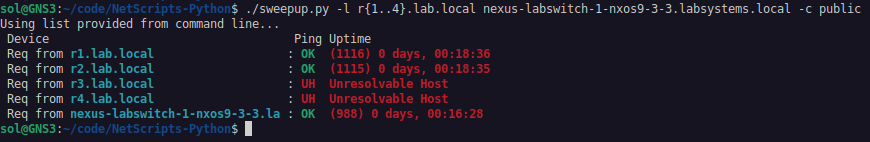
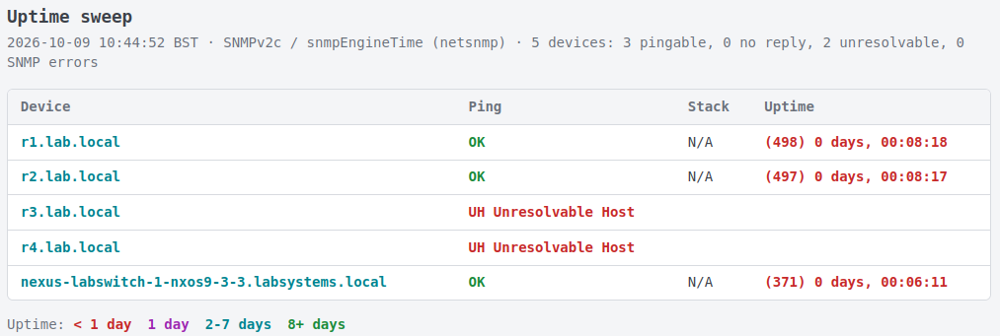

# Netscripts

This is a selection of bash-ported python scripts used for network
support/engineering purposes. These were originally written many moons
ago but have been reviewed/refactored with GPT/Claude to fix some
bugs and to add new features which has saved my aging brain some work.

- sweepup:          Sweep uptime of devices + stack status if desired

Use at your own risk etc etc, no liability accepted.

## sweepup

Sweep Uptime of multiple devices to check for reboots and reachability.

```text
Usage: ./sweepup [options] -l target1 target2  ...
       ./sweepup [options] search-string

Options:
 -v3                  Use SNMPv3 with credentials set in script
 -c COMMUNITY         Override default SNMPv2C community string
 -e                   Use sysUpTime instead of snmpEngineTime
 -f FILENAME          Search device names from a hosts style file
 -l device1 device2   Specify list of devices to sweep
 -s                   Try to verify status of Cisco Stack members
 --html filename.html Output to HTML file

 If using IPs or FQDNs, specify with a list after -l
 If wanting to just search within a hosts style file, use a string or regex

Examples:
  ./sweepup.py router[123]
  ./sweepup.py -f /etc/hosts lon
  ./sweepup.py -c READONLY -l router1.lab.local
  ./sweepup.py -s -l 192.168.122.2 192.168.122.3
  ./sweepup.py -l router{1..8}.lab.local
  ./sweepup.py -l 192.168.122.{2..6} -c public --html output.html
```





